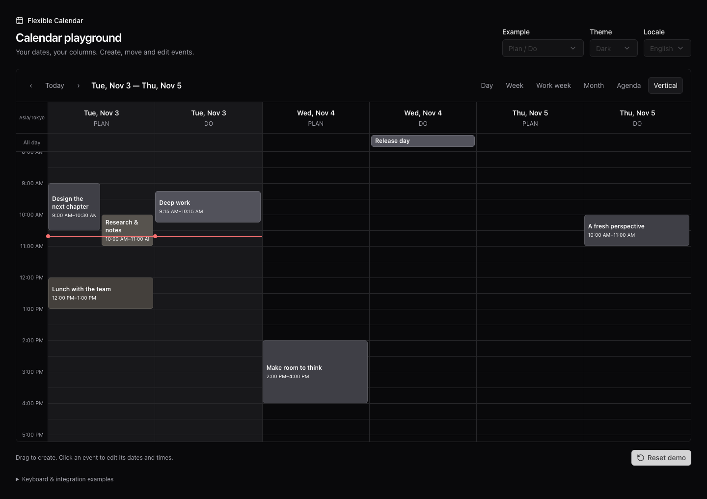

# Flexible Calendar

A TypeScript calendar for plain DOM, React and Vue. Show **multiple columns for each date** to compare planned and actual time, people or rooms side by side. An event keeps its ID and timestamps even when it spans midnight. Day, week, work-week, month and agenda views use the same event data.

**Version 0.1.0 · MIT.** The API may change before 1.0. Until the first npm release, you can [run the playground or build an installable tarball](#try-it-locally).



## Why I built this

I built Flexible Calendar for my own time-management app, where I use it to compare what I planned to do with what I actually did. Two needs shaped its design:

- **Plan and Do side by side for each date.** I wanted each day to have its own Plan and Do columns, so I could compare planned and actual time on the same time axis without switching calendars or views.
- **One event, even across midnight.** An activity from 23:00 to 01:00 is still one activity. I wanted it to appear on both days while keeping a single event ID and its original start and end timestamps, without making the application maintain separate events for each day.

Before building this library, I compared several well-known calendar libraries, but none of the ones I evaluated met these needs. A smaller, independently maintained project may already offer a suitable solution; I am not claiming that none exists. My initial preference was to build on an established library. When the options I evaluated did not fit, I decided to build my own.

These needs led to date × resource columns and rendering that splits events across days while preserving the original event. Plan and Do are one use of those columns; people and rooms can use the same model.

I use the library in my own app and am developing it as an open-source project. Its API is still evolving as I use it in practice.

## Features

- Day, week, work-week, month, agenda and configurable N-day vertical views.
- Continuous multi-day month bars, 4–6 week grids and an accessible overflow popup.
- Column-level time-view updates; [reproducible performance measurements](docs/performance.md).
- Multiple resource columns per day, including different resources on different dates.
- Timed, all-day, overlapping and multi-day events; exclusive end times.
- Pointer selection, event movement, start/end resize, cross-date/resource movement, external drops and drag auto-scroll.
- Keyboard creation, movement and resizing; touch tapping/scrolling and event dragging.
- Controlled event data, validation/veto callbacks, range notifications and navigation.
- IANA time zones, configurable week starts, locale-aware formatting and translated messages.
- Light, dark, system theme, RTL, CSS variables, custom event/header rendering and style callbacks.
- Typed ESM entry points; React and Vue are optional peers, never required by the engine or DOM renderer.

See [API](docs/api.md), [feature comparison](docs/features.md), [date/time behavior](docs/dates.md), and [verification and release notes](docs/verification.md). This is an independent implementation, not a prop-compatible fork of react-big-calendar.

## Try it locally

Requires Node.js 20.19+ (or 22.12+) and npm.

```sh
git clone https://github.com/yossyi0323/flexible-calendar.git
cd flexible-calendar
npm ci
npm run dev
```

Open the URL printed by Vite. The playground includes Plan/Do, meeting-room and personal-calendar examples, all views, a shadcn/ui editor with direct start/end date-time input, all-day dates, column selection, locale and light/dark theme controls. Inputs use the displayed calendar time zone and invalid intervals cannot be saved. React and Vue examples are linked below the playground. No account, database, or environment variables are required.

```sh
npm run check                    # typecheck, unit tests, ESM + declaration build
npx playwright install          # test browsers
npm run test:e2e                 # browser interactions
npm run test:package             # publint + Are the Types Wrong?
npm run format:check
npm pack                        # local installable tarball; does not publish
```

Install the resulting `.tgz` in a separate test application with `npm install /absolute/path/to/package.tgz`.

## Plain TypeScript

```ts
import { createCalendar } from "@yossyi0323/flexible-calendar/dom";
import { atMinute, type CalendarEvent } from "@yossyi0323/flexible-calendar";
import "@yossyi0323/flexible-calendar/style.css";

const timeZone = "Asia/Tokyo";
const day = "2026-11-03";
let events: CalendarEvent[] = [
  {
    id: "focus",
    title: "Focus time",
    resourceId: "plan",
    start: atMinute(day, 9 * 60, timeZone),
    end: atMinute(day, 10 * 60, timeZone),
  },
];

const calendar = createCalendar(
  document.querySelector<HTMLElement>("#calendar")!,
  {
    date: atMinute(day, 0, timeZone),
    view: "vertical",
    days: 3,
    timeZone,
    events,
    resources: [
      { id: "plan", title: "Plan" },
      { id: "do", title: "Do" },
    ],
    theme: "auto",
    scrollToMinute: 8 * 60,
    onEventChange(change) {
      events = events.map((event) => {
        if (event.id !== change.event.id) return event;
        const { resourceId: oldResource, ...rest } = event;
        return {
          ...rest,
          start: change.start,
          end: change.end,
          allDay: change.allDay,
          ...(change.resourceId === undefined
            ? {}
            : { resourceId: change.resourceId }),
        };
      });
      calendar.update({ events });
      // Persist through your own API, or keep the original array to reject the edit.
    },
    onSelectSlot(slot) {
      console.log(slot.start, slot.end, slot.resourceId);
    },
  },
);

// During application cleanup:
// calendar.destroy();
```

No virtual date, date-encoded resource ID, manual midnight splitting, or synthetic continuation ID is needed. A two-day event is supplied once. All rendered fragments point to that same original event.

## React

```tsx
import { Calendar } from "@yossyi0323/flexible-calendar/react";
import "@yossyi0323/flexible-calendar/style.css";

<Calendar
  date={date}
  view="week"
  events={events}
  timeZone="Asia/Tokyo"
  theme="auto"
  onEventChange={handleChange}
  renderReactEvent={(event) => <strong>{event.title}</strong>}
/>;
```

Use React/React DOM 18 or later. The wrapper mounts after hydration and works in StrictMode. Custom content uses portals, preserving React context. For a Next.js application, import the component in a client component and the stylesheet in the appropriate application CSS entry. See the runnable [React example](examples/react.tsx).

## Vue 3

```vue
<script setup lang="ts">
import { reactive } from "vue";
import {
  Calendar,
  type CalendarOptions,
} from "@yossyi0323/flexible-calendar/vue";
import "@yossyi0323/flexible-calendar/style.css";

const options = reactive<CalendarOptions>({
  date: new Date(),
  events: [],
  view: "month",
  theme: "auto",
});
</script>

<template>
  <Calendar :options="options">
    <template #event="{ event }"
      ><strong>{{ event.title }}</strong></template
    >
  </Calendar>
</template>
```

The Vue adapter handles reactive updates and cleanup; slots use Teleport. See the runnable [Vue example](examples/vue.ts). Svelte, Angular and other frameworks can mount `createCalendar` into a lifecycle-managed element, or build their own renderer on the headless exports.

## Independent engine

```ts
import {
  buildColumns,
  splitEvent,
  layoutSegments,
} from "@yossyi0323/flexible-calendar";

const columns = buildColumns(config);
const segments = events.flatMap((event) =>
  splitEvent(event, [columns[0]!.date], "Asia/Tokyo"),
);
const positions = layoutSegments(segments); // normalized left/width, wall-clock minutes
```

The root entry never imports React, Vue or the DOM renderer. See [architecture](docs/architecture.md) for the extension boundaries.

## Scope

This package supplies calendar UI, layout and interaction calculations. Applications own persistence, authorization, event editors, recurrence expansion and undo/redo. The examples are memory-only. No consumer application's code is modified by this repository.

MIT licensed. See [contributing](CONTRIBUTING.md) and [release procedure](docs/releasing.md).
